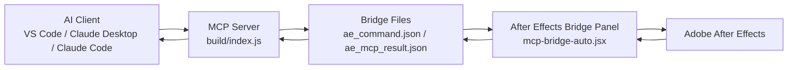
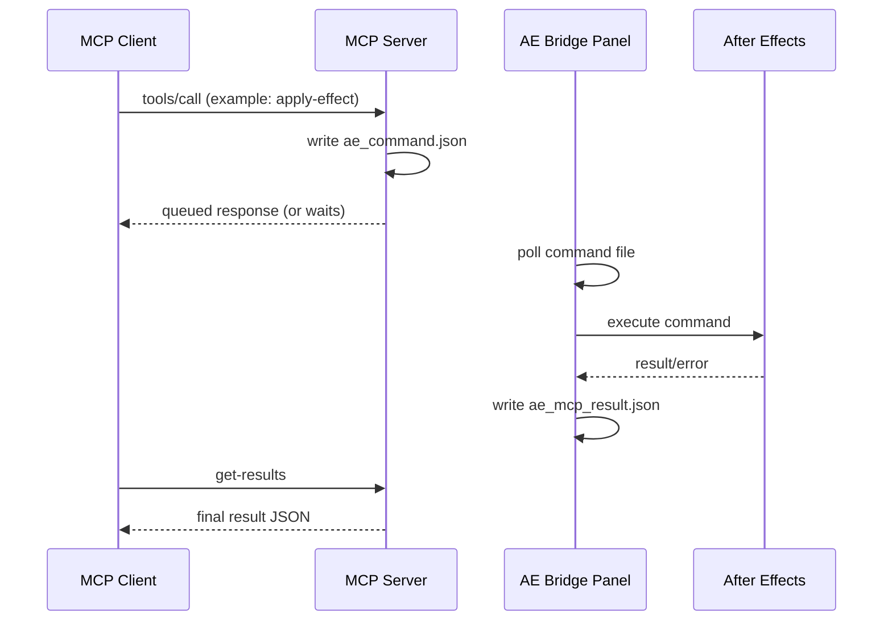

# After Effects MCP Server

[](https://nodejs.org/)
[](https://www.adobe.com/products/aftereffects.html)
[](#development)
[](LICENSE)

Control Adobe After Effects through MCP using a bridge panel running inside AE.
This project is optimized for practical automation workflows: effects, presets, keyframing, markers, and audio-aware tooling.

---

## Highlights

- Full composition and layer automation.
- Deep effect inspection and property editing.
- Advanced effect graph controls (temporal + spatial).
- Preset search/list/apply workflows.
- Marker and audio automation, including waveform-to-marker pipelines.
- Installed effect catalog discovery (`list-available-effects`).

## Feature Matrix

| Area | Capabilities |
|---|---|
| Composition | Create, inspect project/compositions, get clip frame ranges |
| Layers | Text/shape/solid/adjustment creation, transform/property updates, centering |
| Animation | Layer keyframes, expressions, effect keyframes with graph controls |
| Effects | Apply by name/matchName, list layer effects recursively, edit any effect property, remove effects |
| Presets | Apply `.ffx`, list/search preset libraries |
| Markers | Add single marker (comp/layer), add markers in bulk |
| Audio | Set channel levels, inspect audio metadata, analyze WAV waveform, detect peaks |

## Script Sandbox (this fork)

This fork lets an MCP client run **any ExtendScript** in After Effects, while keeping file changes inside **one folder you choose per project**. You no longer need a new bridge command for every task.

**How it works**

- **Choose the writable folder:** the bridge panel docks like any AE panel. Open it from `Window -> mcp-bridge-auto.jsx`, and in "Claude's writable folder" click **Browse...** to pick the folder the client may modify for the open project.
  - The choice is remembered per `.aep`.
  - A new or unsaved project starts with no folder, so no file writes and no scripts until you pick one.
  - Only you can set it. Scripts can't change it.
- **New tools:**
  - `get-sandbox-folder`: reports the open project and its folder, and confirms which project later commands are meant for.
  - `run-script-code`: runs inline code. Write it as a function body and use `return` to hand back a value.
  - `run-script-file`: runs a `.jsx` that's inside the folder.
- **Every script run:**
  - saves the project and keeps a rolling backup (newest 10, in `mcp-scripts/backups/`)
  - runs as one undo step
  - is archived to `mcp-scripts/` and logged to `mcp-scripts/run-log.txt`
- **Inside scripts:**
  - Writes, deletes and renames outside the folder are blocked.
  - Calls AE can't intercept are refused before the script runs: `system.callSystem`, `app.project.save(path)`, `renderQueue.render()`, `saveFrameToPng`, `$.evalFile`, `eval`.
  - Use the `sandbox` helper instead: `sandbox.saveAs`, `sandbox.render`, `sandbox.saveFrameToPng`, `sandbox.path`.
  - Reading and importing files from anywhere still works.
- **Wrong-project guard:** every command carries the project the client expects. If you switch projects mid-task, the bridge refuses instead of editing the wrong file.
- **Pause:** tick **Pause** in the panel to refuse all commands without losing the folder.

**This is a guardrail against accidents, not a security sandbox.** Deliberately written ExtendScript can still escape it. Anything that can run `AfterFX.exe -r` on your machine bypasses the panel entirely.

The bridge protocol is documented in [`docs/bridge-protocol.md`](docs/bridge-protocol.md).

## Requirements

- Adobe After Effects
- Node.js 18+
- npm

In After Effects, enable:

- `Edit -> Preferences -> Scripting & Expressions -> Allow Scripts to Write Files and Access Network`

## Quick Start

1. Clone and install:

```bash
git clone https://github.com/spencerpruitt/after-effects-mcp.git
cd after-effects-mcp
npm install
```

2. Build:

```bash
npm run build
```

3. Install bridge script:

```bash
npm run install-bridge
```

4. Restart After Effects and open:

- `Window -> mcp-bridge-auto.jsx`
- Keep this panel open during MCP usage.

## MCP Client Config

Use an absolute path to `build/index.js`.

```json
{
  "mcpServers": {
    "AfterEffectsMCP": {
      "command": "node",
      "args": ["<absolute-path-to-repo>/build/index.js"]
    }
  }
}
```

## Add to VS Code

If you use an MCP-capable VS Code extension, add this server in that extension's MCP server settings.

Use:

- command: `node`
- args: `["<absolute-path-to-repo>/build/index.js"]`

Example snippet many extensions accept:

```json
{
  "mcpServers": {
    "AfterEffectsMCP": {
      "command": "node",
      "args": ["C:\\Users\\<you>\\Documents\\Projects\\AEMCP\\build\\index.js"]
    }
  }
}
```

Then:

1. Restart VS Code.
2. Open After Effects and keep `Window -> mcp-bridge-auto.jsx` open.
3. Call a simple tool like `get-help` or `run-script` with `getProjectInfo`.

## Add to Claude Desktop

Edit Claude Desktop config and add the MCP server entry.

Typical Windows config location:

- `%APPDATA%\\Claude\\claude_desktop_config.json`

Example:

```json
{
  "mcpServers": {
    "AfterEffectsMCP": {
      "command": "C:\\Program Files\\nodejs\\node.exe",
      "args": [
        "C:\\Users\\<you>\\Documents\\Projects\\AEMCP\\build\\index.js"
      ]
    }
  }
}
```

After saving:

1. Fully restart Claude Desktop.
2. Open AE bridge panel.
3. Verify with `tools/list` in logs or by calling a known tool.

## Add to Claude Code

Configure the same server command/args in your Claude Code MCP configuration.

Use this server definition:

```json
{
  "AfterEffectsMCP": {
    "command": "node",
    "args": ["<absolute-path-to-repo>/build/index.js"]
  }
}
```

Then:

1. Restart Claude Code or reload MCP servers.
2. Ensure After Effects is open with `mcp-bridge-auto.jsx` panel running.
3. Test with `get-results` after a queued command.

## Architecture Graph



## Command Flow Graph



## Typical Runtime Flow

1. Start your MCP client (it starts this server).
2. Keep AE bridge panel open.
3. Call tools.
4. If response says queued, call `get-results` after 1-3 seconds.

Note: some AE operations finish slightly after tool timeout windows; `get-results` usually contains the final state.

## Tool Catalog

### General

- `run-script`
- `get-results`
- `get-help`

### Composition and Layer Utilities

- `create-composition`
- `create-adjustment-layer`
- `center-layers`
- `get-layer-clip-frames`

### Effects and Presets

- `apply-effect`
- `add-any-effect`
- `mcp_aftereffects_applyEffect`
- `apply-effect-template`
- `list-layer-effects`
- `list-available-effects`
- `set-effect-property`
- `set-effect-keyframe`
- `remove-effect`
- `apply-preset`
- `list-presets`
- `search-presets`

### Markers and Audio

- `add-marker`
- `add-markers-bulk`
- `set-audio-levels`
- `get-audio-info`
- `analyze-audio-waveform`

### Diagnostics and Helpers

- `test-animation`
- `run-bridge-test`
- `mcp_aftereffects_get_effects_help`

## Audio to Marker Workflow

1. `get-audio-info` on target layer.
2. Copy `sourceFilePath`.
3. `analyze-audio-waveform` with optional `numPoints`.
4. Convert `peakTimes` to `markers[]`.
5. `add-markers-bulk`.

## Project Layout

- `src/index.ts` - MCP server and tool definitions
- `src/scripts/mcp-bridge-auto.jsx` - AE bridge panel
- `install-bridge.js` - bridge installer

## Development

Build:

```bash
npm run build
```

Install bridge:

```bash
npm run install-bridge
```

Run server directly:

```bash
node build/index.js
```

Tests:

```bash
npm test                                      # path-policy unit tests (no AE needed)
npm run test:e2e -- --i-saved-my-project      # end-to-end against a running AE with the panel open
```

The end-to-end suite closes your open project, works in a throwaway one, then reopens yours. Save first. See [`test/e2e/README.md`](test/e2e/README.md).

## Troubleshooting

### Server does not start

- Run `npm run build`.
- Check MCP logs for startup exceptions (for example duplicate tool registration).

### Commands queue but do not complete

- Ensure AE bridge panel is open.
- Confirm AE scripting/network permission is enabled.
- Retry and call `get-results` after a short delay.

### Results appear stale

- Reopen bridge panel.
- Send a new command and then call `get-results`.

### Program Files install fails

- Expected without elevated permissions.
- User AppData script paths are usually sufficient.

## Premiere Pro

A second MCP server, `premiere`, drives Adobe Premiere Pro through a UXP panel, the same way the
`after-effects` server drives AE. Both servers run side by side in one Claude Code session, so Claude can
render shots in AE and then import them into Premiere, assemble and trim a sequence, add markers, audio,
transitions and speed changes, export, and save. Design and protocol: `docs/premiere-bridge-spec.md`.

### Requirements

- Premiere Pro **25.6 or later** (UXP is GA from 25.6). Tested target: **26.5** on Windows 11.
- Node.js 18+, and this repo built (`npm install`, `npm run build`).
- Creative Cloud Desktop (it installs the `.ccx` panel package).

### Install the panel

```bash
npm run install-premiere-panel              # packages build/premiere-mcp-bridge.ccx
npm run install-premiere-panel -- --install # ...and installs it through Adobe's UPIA command-line installer
```

If `--install` can't find or run Adobe's Unified Plugin Installer Agent (it may need admin rights), either:

- double-click `build\premiere-mcp-bridge.ccx` (Creative Cloud Desktop asks you to confirm a plugin from outside
  the Marketplace), or
- for development, enable **Developer Mode** in Premiere's Plugins settings, then use the UXP Developer Tool:
  *Add Plugin* → `src/premiere-uxp/manifest.json` → *Load*. Dev-loaded plugins must be reloaded after every
  Premiere restart.

Then open **Window → UXP Plugins → MCP Bridge** and keep the panel open while you work.

### Register both servers in Claude Code

```bash
claude mcp add after-effects -- node <repo>/build/ae.js
claude mcp add premiere -- node <repo>/build/premiere.js
```

`<repo>` is the absolute path of your clone (for example `D:\Projects\after-effects-mcp`). `build/index.js`
still works for After Effects, so existing configs don't need to change. Each server has its own lock and its
own confirmed project, so a long AE render never blocks Premiere commands.

### The panel

- Shows the target (or active) project and its **sandbox folder**, marked "(default)" when it was inherited
  from a remembered root.
- **Browse… / Clear / Forget default** set the folder. New projects can only be created inside a remembered
  default root (for example `D:\Projects\MyFilm\edit\`).
- **Pause** refuses every command (`PAUSED`) until you resume.
- **Allow test harness** enables the e2e-only commands. It is unticked at every launch and never saved.
- A log view lists each command and its result.

### Safety model

- **Targeting by path.** Every command names its project. The panel looks it up among the open projects and
  never falls back to whichever one is active (`PROJECT_NOT_OPEN`, `PROJECT_UNSAVED`).
- **Reads anywhere, writes only inside the sandbox folder.** Save As, exports (including Media Encoder jobs,
  checked when queued), frame grabs, script archives and scratch-disk changes must stay inside the folder
  (`OUTSIDE_FOLDER`). Premiere's own previews, auto-save, media cache and peak files are exempt.
- **Save + backup before every change.** Each mutating tool and each script first saves the project and copies
  the `.prproj` to `<folder>\mcp-scripts\backups\` (the newest 10 are kept). Each typed tool is one undo step;
  results report `undoSteps` and `backupPath`.
- **Scripts** (`premiere-run-script-code` / `-file`) run with guarded `fs`, `require` and `ppro` plus a static
  scan for blocked identifiers (`BLOCKED_CALL`), and are archived with a run log in `<folder>\mcp-scripts\`.
- **Honest limit:** as with the AE panel, these guards are **best-effort**. Determined code inside a UXP plugin
  with full file-system access can get around them. The protections that matter are the path targeting, the
  backup taken before each run, and the fact that you can read every script Claude writes.

### Known gaps

Not reachable from a script, so Claude will ask you to do them by hand: menu commands and keyboard shortcuts,
rendering previews, creating multicam sequences, a true Nest (UXP only offers a sub-sequence), panel focus and
workspaces, dismissing arbitrary modal dialogs, applying `.ffx` effect presets, and (unconfirmed) complex
Lumetri curves. UI automation is deliberately out of scope. Details for script authors are in
`docs/premiere-uxp-cheatsheet.md`, which Claude reads through `premiere-get-api-help`.

### Sidecar (speed, audio transitions, link/unlink)

Premiere 26.5's UXP API can't change clip speed, add audio transitions (its `TransitionFactory` is
video-only) or link/unlink clips. Those three go to a small CEP/ExtendScript extension, the **MCP Sidecar**
(`src/premiere-cep/`), that does exactly those operations and nothing else: there is no arbitrary-code tool.
The server routes them for you:

| Tool | Goes to |
|---|---|
| `premiere-set-speed` | sidecar (`setSpeed`) |
| `premiere-add-transition` on an audio track (`A1`, `A2`...) | sidecar (`addAudioTransition`); video tracks stay on the UXP panel |
| `premiere-link-clips { sequence, items: [{ track, index }], link }` | sidecar (`link` / `unlink`) |

If the sidecar isn't running (no heartbeat in the bridge folder in the last 6 s), these tools return
`NEEDS_SIDECAR_UNAVAILABLE` with the install steps and send nothing.

**Install:**

```bash
npm run install-premiere-sidecar                                 # dry run: prints exactly what it would change
npm run install-premiere-sidecar -- --install --enable-debug     # copy the extension + allow unsigned extensions
```

- It copies `src/premiere-cep` to `%APPDATA%\Adobe\CEP\extensions\com.mcp.premiere.sidecar`.
- `--enable-debug` sets `HKCU\Software\Adobe\CSXS.12` → `PlayerDebugMode = "1"` (Premiere 26 ships CEP 12).
  CEP only loads unsigned extensions with this on, and it applies to **every** unsigned CEP extension for
  your Windows user, not just this one. Skip it if you'd rather sign the extension as a ZXP yourself.
  `--csxs 12,13` targets other CEP versions.
- Restart Premiere, open **Window → Extensions (Legacy) → MCP Sidecar** once (you can dock it or close it
  afterwards), and keep the **MCP Bridge** panel open as well.

**How it stays inside the same safety model:** the sidecar uses the same command protocol (`prx_command.json`
/ `prx_mcp_result.json`), stale check, project targeting by path and save + rolling backup as the panel. It
never stores settings: the UXP panel writes a read-only mirror of **Pause** and the open projects' folders to
`pr_sidecar_state.json`, and the sidecar refuses everything when that mirror is missing or older than 10 s.
QE and the timeline selection only follow the *active* project, so sidecar edits need the target project in
front (`TARGET_NOT_ACTIVE` otherwise).

**Caveats:**

- It uses Premiere's QE DOM, which Adobe calls undocumented and unsupported. Every result carries read-back
  values (speed, transition spans, linked-item counts) so a silent no-op shows up as an error.
- **CEP sunset:** Adobe stops new CEP Marketplace submissions in December 2027, disables CEP by default in
  **December 2028** and removes it in December 2029. When CEP goes, the sidecar tools fall back to
  `NEEDS_SIDECAR_UNAVAILABLE`.

### End-to-end tests

See `test/e2e/README.md`. The Premiere suite runs against throwaway projects under `%TEMP%\pr-mcp-e2e-*`,
opened next to yours, and needs "Allow test harness" ticked.

### Maintainers: publishing

`npm run scrub-check -- <ref>` (default `public-scrub`) greps every file of `<ref>` and the metadata of commits
not yet on `fork/main` against an untracked `.scrub-denylist` (one regex per line, case-insensitive). It refuses
to run without the denylist and exits non-zero on any hit.

## License

MIT. See `LICENSE`.

## Inspo

https://github.com/Dakkshin/after-effects-mcp

I took the base code from them but added a lot
